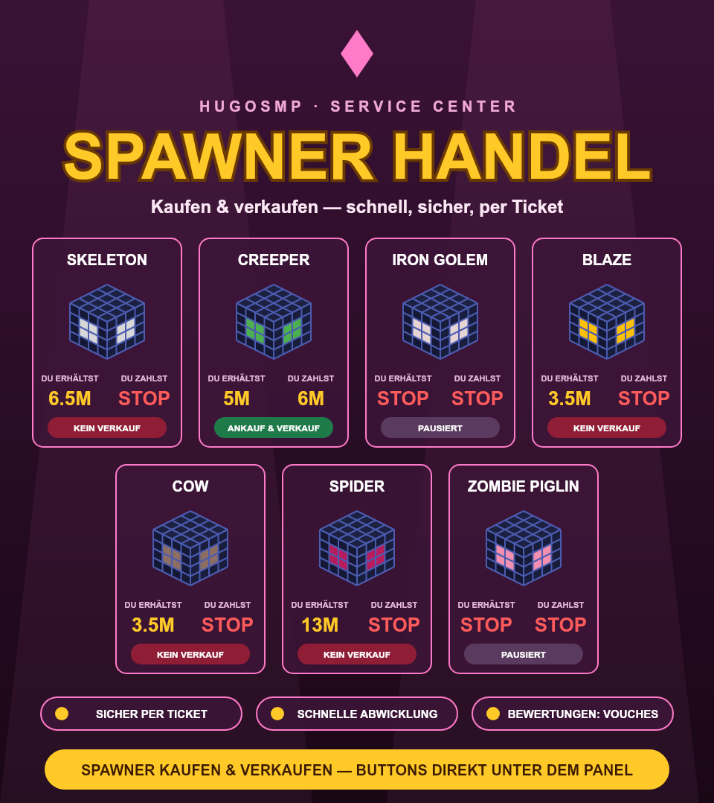

# HugoSMP Service Center Bot

Discord-Bot + Website für das HugoSMP Service Center: Map-Arts, AFK-Service (22h Uptime), Spawner-Handel, Tickets und Vouches.

Läuft auf **mehreren Discord-Servern gleichzeitig** – jeder Server hat eigene Services, Preise, Spawner, Tickets, Vouches und eigenes `/setup`.



## Features

- **Service-Panel** – Services per `/service add | remove | toggle | limit | rolle` verwalten, eigene Support-Rollen pro Service (z. B. AFK-Service), Ticket-Limits
- **Map-Art-Verkauf** – `/mapart` postet Bild, Preis, Größe und Besitzer; 3T-Besitzer werden dem Ticket hinzugefügt
- **Map-Art-Panel** – Übersicht aller verfügbaren Map-Arts mit Kauf-Dropdown, aktualisiert sich automatisch
- **AFK-Panel** – Standard oder Deluxe (mit Farm-Refill, Aufpreis + Material), 22h oder 20h Uptime, Verkauf per /order oder /sell; Preise per `/afkpreis`
- **Custom Map-Art** – Carpet/Block · 2D/3D, Preis pro Map per `/custompreis`
- **Spawner-Handel** – gerendertes Panel, Kauf/Verkauf-Buttons, „Preise aktualisieren“ zeigt jedem den neuesten Stand, „Preise setzen“ (nur Team) oder `/spawner set` ändert sie
- **Schematics** – `/schematic` mit Vorschaubild + hinterlegter Datei, Übersichts-Panel; Datei wird nach Bezahlung im Ticket per Button ausgeliefert (DM + Ticket)
- **Support-Tickets** – Panel mit Themen (Frage, Bestellung, Report, Sonstiges)
- **Vouches per DM** – automatisch nach Ticket-Schließung oder per `/vouchanfrage @kunde`, Veröffentlichung im Vouch-Kanal
- **AFK-Tickets** – Team übernimmt per Button, Kunde voucht im Ticket (Button oder `/vouch`) für den Übernehmer; danach läuft der Vouch-Button aus und die DM-Anfrage entfällt
- **Website** – zeigt Services, Spawner-Preise, Map-Arts, Custom-Preise und Vouches live

## Setup

Benötigt Node.js 20+.

```bash
npm install
cp .env.example .env   # TOKEN eintragen
npm start              # Bot + Website (Port 3000), Hoster: Startdatei index.js
```

Dann in Discord `/setup` (Kanäle & Rollen), optional `/ticketkategorie` pro Bereich.

Panels posten: `/panel typ:Services`, `/panel typ:Custom Map-Art`, `/panel typ:Spawner Handel`, `/panel typ:AFK Service`, `/panel typ:Map-Arts`, `/panel typ:Schematics`, `/panel typ:Support`.

Nur Website starten: `npm run web` · Tests: `npm test`
